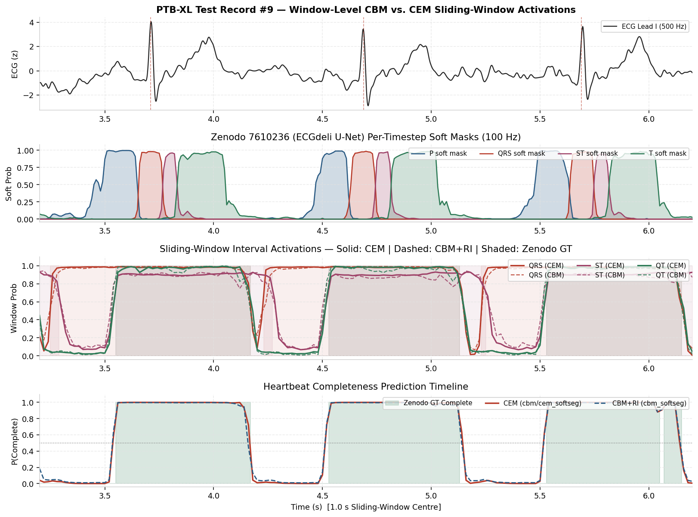
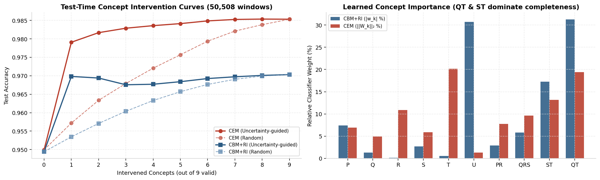
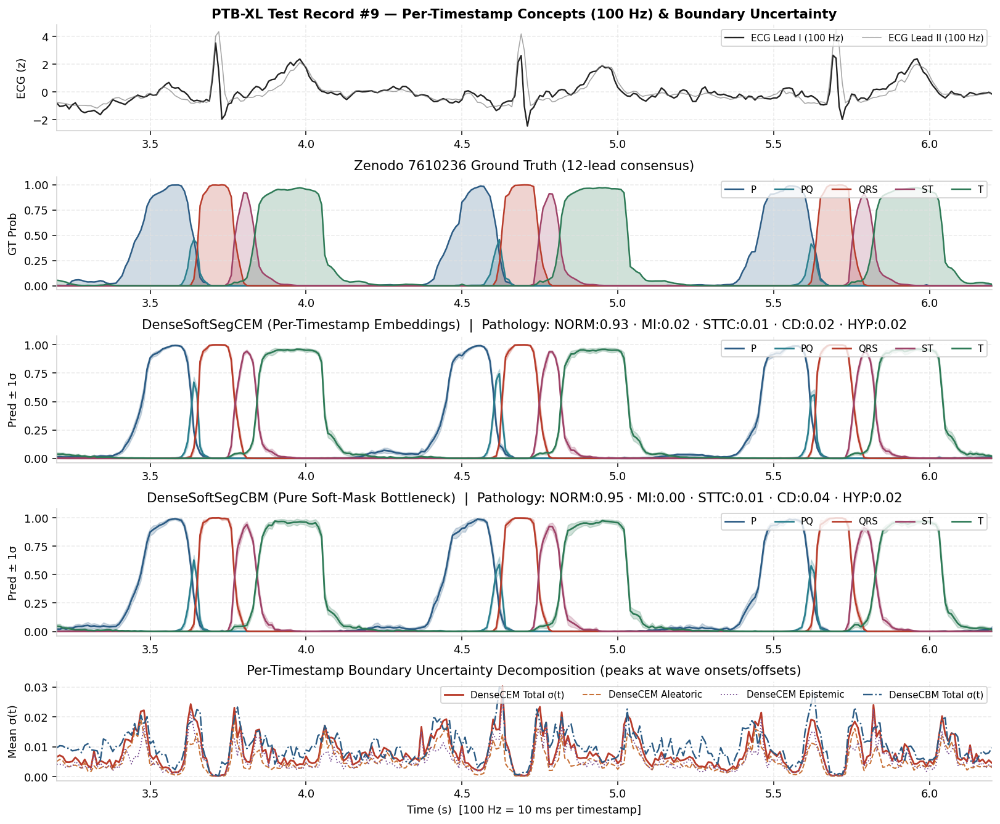
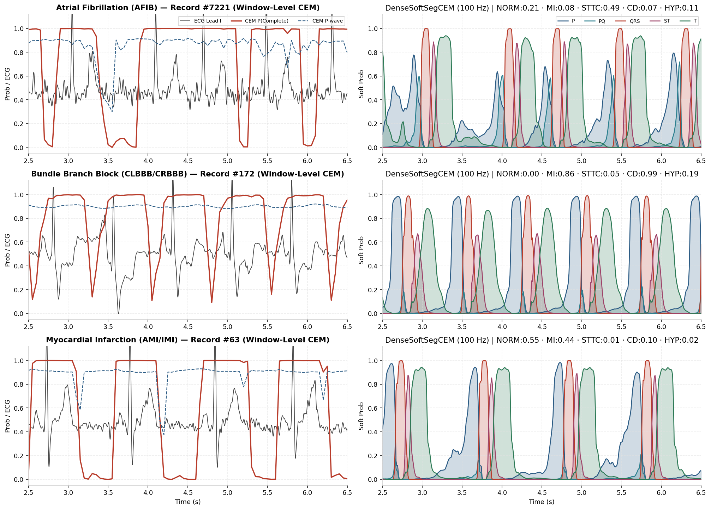
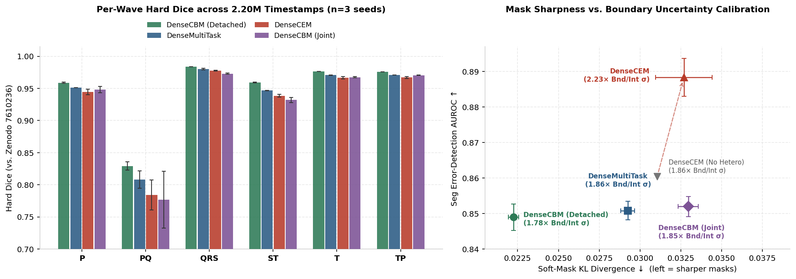
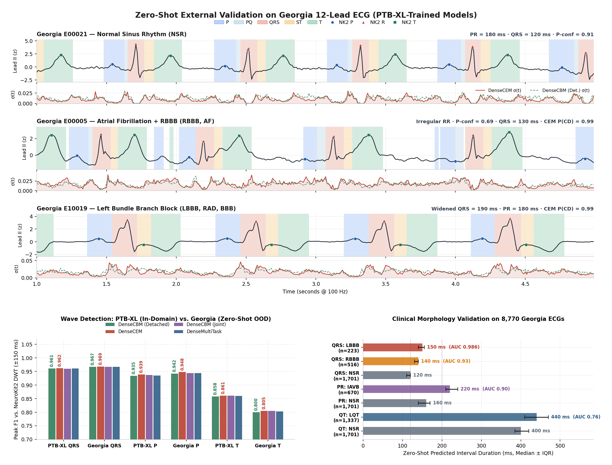

# ECG Heartbeat CBM, CEM & Per-Timestamp Soft-Segmentation

Interpretable 12-lead ECG analysis on [PTB-XL](https://physionet.org/content/ptb-xl/) combining **Concept Bottleneck Models (CBM)**, **Concept Embedding Models (CEM)**, and **Per-Timestamp Dense 1D U-Net Soft-Segmentation CBM/CEM** with epistemic + aleatoric uncertainty decomposition, causal test-time concept interventions, and an interactive FastAPI + D3 v7 Explorer.

> **PTB-XL Data Exploration & Quality Audits**: Comprehensive PTB-XL v1.0.3 data exploration, artifact audits, and Zenodo 7610236 delineation quality notebooks live in [explainable-ecg-learning/ecg-data-repo](https://github.com/explainable-ecg-learning/ecg-data-repo) (`ptbxl/notebooks/`).

---

## Model Families & Architecture

This repository implements **three complementary interpretable ECG paradigms**:

```
1. Window-Level Heartbeat Completeness (1.0 s @ 500 Hz, 10 concepts)
   (B, 12, 500) ─▶ TemporalEncoder (1D ResNet → GAP → z ∈ ℝ⁵¹²)
        ├─▶ CBM + RandInt ("cbm") : ECGConceptLayer (μ_k, log σ²_k) ─▶ UncertaintyClassifier
        ├─▶ CEM + RandInt ("cem") : ConceptEmbeddingLayer (c⁺_k, c⁻_k ∈ ℝ¹⁶, μ_k, log σ²_k) ─▶ CEMClassifier
        └─▶ Black-Box ("blackbox"): Linear(512, 1)

2. Per-Timestamp Dense Soft-Segmentation + 5-Class Pathology (10.0 s @ 100 Hz)
   (B, 12, 1000) ─▶ TemporalUNet1D (1D ResNet U-Net → Z ∈ ℝ⁶⁴ˣ¹⁰⁰⁰, 10 ms resolution)
        ├─▶ DenseSoftSegCBM ("dense_cbm"): per-timestamp p(c_t | x) ∈ Δ⁶ˣ¹⁰⁰⁰ & log σ²_{k,t}
        │                                  ─▶ mask-only temporal head ─▶ 5 pathologies
        └─▶ DenseSoftSegCEM ("dense_cem"): per-timestamp c⁺_{k,t}, c⁻_{k,t} ∈ ℝ¹⁶ + scorer
                                           ─▶ mixed ĉ_{k,t} (w/ temporal RandInt) ─▶ attention head ─▶ 5 pathologies

3. Record-Level Clinical Pathology Bottleneck (10.0 s @ 100 Hz, 20 clinical concepts)
   (B, 12, 1000) ─▶ AttentionTemporalEncoder ─▶ 20 concepts (concepts.parquet) ─▶ 5 pathologies
```

- **Window-Level Concepts (`src/models.py`)**: `[P, Q, R, S, T, U, PR, QRS, ST, QT]`, supervised via NeuroKit2 or [Zenodo 7610236](https://zenodo.org/records/7610236) (`KIT-IBT/ECGdeli` U-Net; `U`-wave automatically confidence-masked via `w_U = 0`).
- **Per-Timestamp Concepts (`src/dense_seg.py`)**: `wave6` (`[P, PQ, QRS, ST, T, TP]` partitioning all 24 Zenodo/ECGdeli classes into a probability simplex at every 10 ms timestamp) or `fiducial24` (all 24 onset/peak/offset classes), predicting **5 PTB-XL diagnostic superclasses** (`NORM, MI, STTC, CD, HYP`).
- **Uncertainty & Faithfulness**: Heteroscedastic concept heads (aleatoric) + BatchNorm-safe MC-Dropout (epistemic), test-time concept interventions (uncertainty-guided vs. random), Counterfactual Flip Rate, and Oracle Impurity Score (OIS).

---

## Key Benchmark Results (PTB-XL Test Fold 10)

### 1. Window-Level CBM vs. CEM — Dense Sliding-Window Cross-Delineator Benchmark
Evaluated on **36,200 dense sliding windows** (200 unseen Fold-10 records, `stride = 25` samples = 50 ms) against both **Zenodo 7610236 (ECGdeli U-Net)** and **NeuroKit2** ground truth, plus full test-set faithfulness & leakage:

| Model | Trained On | vs. Zenodo/ECGdeli Acc / AUROC | vs. Zenodo Macro-F1 (`QT`) | vs. NeuroKit2 Acc | Counterfactual Flip Rate ↑ | Impurity OIS ↓ | Test Interventions (0 → 9) |
|---|---|---:|---:|---:|---:|---:|---:|
| *NK2 ↔ ECGdeli ceiling* | — | *0.8938 / —* | *0.9774 (0.931)* | *0.8938* | — | — | — |
| `cbm_randint_v2` | NK2 beats | 0.7010 / 0.7740 | 0.9167 (0.734) | 0.7455 | 0.946 | **0.099** | — |
| `cem_v2` | NK2 beats | 0.7222 / 0.7896 | 0.9515 (0.784) | 0.7655 | 0.620 | 0.292 | — |
| **`cbm_softseg`** | **Zenodo SoftSeg SW** | **0.9550 / 0.9902** | **0.9888 (0.969)** | **0.8860** | 0.901 | 0.126 | 0.949 → 0.970 |
| **`cbm_softseg_masked`** | **Zenodo SoftSeg SW (`U`-masked)** | — / *0.9820 (test)* | *0.9884* | — | 0.880 | **0.089** | — |
| `blackbox_softseg` | Zenodo SoftSeg SW | — / *0.9827 (test)* | — | — | 0.000 | — | — |
| **`cem_softseg`** | **Zenodo SoftSeg SW** | **0.9570 / 0.9923** | **0.9915 (0.980)** | **0.8875** | **0.980** | 0.258 | **0.950 → 0.985** |

> Blocking the unsupervised `U`-wave residual channel (`mask_unsupervised_concepts=true`) in `cbm_softseg_masked` drops OIS leakage from `0.126` → `0.089` (and eliminates the `30.7%` spurious classifier reliance on `U`) while retaining `0.9484` test accuracy (beating `blackbox_softseg` at `0.9468`).


*PTB-XL Test Record #9: 12-lead ECG waveform, Zenodo 7610236 per-timestamp soft masks, sliding-window interval activations (`QRS, ST, QT`), and heartbeat completeness timeline for `cbm_softseg` vs. `cem_softseg`.*


*Left: Uncertainty-guided vs. random test-time concept intervention curves across 50,508 Fold-10 sliding windows. Right: Learned relative classifier weights across concepts.*

### 2. Per-Timestamp Dense Soft-Segmentation CBM vs. CEM & Matched Baselines (`src/dense_seg.py`)
Evaluated across all **2,198 PTB-XL Test Fold 10 records (2.20M timestamps @ 100 Hz)** over **3 random seeds (`42, 43, 44`, `mean ± std`)** plus ablations (`fiducial24`, RandInt, heteroscedastic loss) and temporal leakage probing:

| Model Family (`n=3` unless noted) | Seg Acc | Hard Macro-Dice | Pathology AUROC | Path ECE ↓ | Task Err-Det ↑ | GT-Mask Interv. | Excess Leakage Δ | Seg Err-Det ↑ | Bnd/Int σ ↑ | Ablate `ST` |
|---|---:|---:|---:|---:|---:|---:|---:|---:|---:|---:|
| `dense_blackbox` (matched U-Net) | — | — | `0.9130 ± 0.0010` | **`0.0390 ± 0.0038`** | `0.8136 ± 0.0020` | — | — | — | — | — |
| `dense_multitask` (seg + direct head) | `0.9638 ± 0.0005` | `0.9380 ± 0.0024` | **`0.9154 ± 0.0015`** | `0.0432 ± 0.0099` | **`0.8227 ± 0.0048`** | — | — | `0.8508 ± 0.0026` | `1.86 ± 0.03×` | — |
| `dense_cbm_joint` (`wave6`, joint) | `0.9592 ± 0.0014` | `0.9280 ± 0.0075` | `0.9090 ± 0.0022` | `0.0510 ± 0.0056` | `0.8167 ± 0.0028` | `0.8276 ± 0.0082` | `+0.0753 ± 0.0049` | `0.8520 ± 0.0028` | `1.85 ± 0.03×` | `0.218 ± 0.051` |
| **`dense_cbm_detached`** (`wave6`, stop-grad) | **`0.9701 ± 0.0003`** | **`0.9472 ± 0.0011`** | `0.8658 ± 0.0005` | `0.0435 ± 0.0049` | `0.7754 ± 0.0033` | `0.8669 ± 0.0014` | **`-0.0022 ± 0.0002`** | `0.8490 ± 0.0037` | `1.78 ± 0.01×` | **`0.201 ± 0.001`** |
| **`dense_cbm_fiducial24`** (24 fiducials, stop-grad, `n=1`) | `0.9438` | `0.8428` | `0.8883 [0.880, 0.897]` | `0.0506` | `0.7962` | **`0.8930`** | **`-0.001`** | `0.7562` | `1.61×` | — |
| **`dense_cem`** (`wave6`, embeddings) | `0.9587 ± 0.0024` | `0.9298 ± 0.0055` | `0.9013 ± 0.0012` | `0.0530 ± 0.0224` | `0.8010 ± 0.0078` | **`0.9016 ± 0.0015`** | `+0.1090 ± 0.0030` | **`0.8884 ± 0.0054`** | **`2.23 ± 0.05×`** | `0.018 ± 0.019` |
| `dense_cem_nohetero` (ablation, `n=1`) | `0.9615` | `0.9376` | `0.9023 [0.894, 0.910]` | `0.0338` | `0.8063` | `0.9023` | `+0.110` | `0.8604` | `1.86×` | `0.008` |


*100 Hz (`10 ms`) per-timestamp `wave6` soft masks (`P, PQ, QRS, ST, T`) predicted by `DenseSoftSegCEM` and `DenseSoftSegCBM` against Zenodo 7610236 ground truth, with synchronized aleatoric + epistemic boundary uncertainty `σ(t)` peaking sharply at wave onsets and offsets.*


*Unseen Fold-10 clinical recordings (`AFIB`, `CLBBB/CRBBB`, `AMI/IMI`): window-level CEM completeness & P-wave tracking (left) paired with per-timestamp `DenseSoftSegCEM` 100 Hz wave masks and 5-class pathology probabilities (right).*

### 2b. Per-Wave Segmentation Comparison Across Model Families
Per-timestamp `wave6` (`[P, PQ, QRS, ST, T, TP]`) and `fiducial24` evaluation against **Zenodo 7610236 (ECGdeli U-Net)** soft ground truth on **PTB-XL Test Fold 10** (`2,198` records · `2.20M` timestamps @ `100 Hz`; `mean ± std` over seeds `42, 43, 44`):

| Model Family (`n`) | Seg Acc | Hard Macro-Dice | `P` | `PQ` | `QRS` | `ST` | `T` | `TP` | Soft MAE ↓ | KL ↓ | Seg Err-Det ↑ | Bnd/Int σ ↑ |
|---|---:|---:|---:|---:|---:|---:|---:|---:|---:|---:|---:|---:|
| **`dense_cbm_detached`** (`n=3`) | **`0.9701 ± 0.0003`** | **`0.9472 ± 0.0011`** | **0.959** | **0.829** | **0.984** | **0.959** | **0.976** | **0.976** | **0.0134** | **0.0223** | 0.8490 | 1.78× |
| `dense_multitask` (`n=3`) | `0.9638 ± 0.0005` | `0.9380 ± 0.0024` | 0.951 | 0.808 | 0.980 | 0.947 | 0.971 | 0.971 | 0.0160 | 0.0292 | 0.8508 | 1.86× |
| `dense_cem` (`n=3`) | `0.9587 ± 0.0024` | `0.9298 ± 0.0055` | 0.945 | 0.784 | 0.978 | 0.939 | 0.966 | 0.967 | 0.0181 | 0.0327 | **0.8884** | **2.23×** |
| `dense_cbm_joint` (`n=3`) | `0.9592 ± 0.0014` | `0.9280 ± 0.0075` | 0.948 | 0.777 | 0.973 | 0.932 | 0.967 | 0.970 | 0.0180 | 0.0330 | 0.8520 | 1.85× |
| `dense_cem_nohetero` (`n=1`) | `0.9615` | `0.9376` | 0.949 | 0.820 | 0.979 | 0.942 | 0.968 | 0.968 | 0.0177 | 0.0311 | 0.8604 | 1.86× |
| `dense_cbm_fiducial24` (`n=1`, 24 cls) | `0.9438` | `0.8428` *(med. 0.895)* | — | — | — | — | — | — | `0.0052` | `0.0343` | 0.7562 | 1.61× |
| `dense_cem_fiducial24` (`n=1`, 24 cls) | `0.9098` | `0.7215` *(med. 0.831)* | — | — | — | — | — | — | `0.0080` | `0.0630` | 0.7956 | 1.82× |
| `dense_blackbox` (`n=3`) | — | — | — | — | — | — | — | — | — | — | — | — |


*Left: Per-wave Hard Dice (`mean ± std`, 3 seeds) showing gradient-isolated `DenseCBM (Detached)` leading across all 6 wave segments, especially narrow `PQ` and `ST`. Right: Soft-mask KL divergence vs. segmentation error-detection AUROC and boundary/interior `σ` contrast.*

- **Gradient isolation gives the sharpest masks**: Detaching downstream task gradients (`dense_cbm_detached`) eliminates task-driven mask distortion—improving Hard Macro-Dice (`0.9280 → 0.9472`), cutting KL divergence by **32%** (`0.0330 → 0.0223`), and boosting narrow `PQ` (`0.777 → 0.829`) and clinically critical `ST` (`0.932 → 0.959`) Dice.
- **Multi-task sharing vs. bottlenecking**: `dense_multitask` achieves strong segmentation (`0.9380` Dice) alongside top pathology AUROC (`0.9154`), showing mild trunk competition compared to `dense_cbm_detached` (`0.9472` Dice) without a causal bottleneck.
- **Mask sharpness vs. boundary uncertainty (`DenseCEM` & heteroscedastic loss)**: `dense_cem` yields the best segmentation error-detection AUROC (`0.8884`) and strongest boundary/interior `σ` peak ratio (`2.23×`). Removing the heteroscedastic MC loss (`dense_cem_nohetero`) sharpens narrow `PQ` (`0.784 → 0.820`) at the expense of error detection (`0.8884 → 0.8604`) and boundary contrast (`2.23× → 1.86×`).
- **Fine-grained `fiducial24` scaling**: `dense_cbm_fiducial24` scales cleanly to all 24 onset/peak/offset classes (`94.38%` acc, `0.8428` Macro-Dice, `0.8883` pathology AUROC), whereas `dense_cem_fiducial24` degrades on rare brief fiducials (`0.7215` Macro-Dice) due to `24×16`-dimensional embedding capacity competition.

### 2c. Zero-Shot External Validation (Georgia 12-Lead ECG)
PTB-XL-trained **Dense CBM / CEM / MultiTask** (`100 Hz`, no fine-tuning) and **Window SoftSeg CBM / CEM** (`500 Hz`) evaluated zero-shot across **8,770 audited `0_clean` US clinical ECGs** from **Georgia 12-Lead ECG** (`data/georgia_ecg`, [ecg-data-repo](https://github.com/explainable-ecg-learning/ecg-data-repo); `500 Hz` polyphase-resampled → `100 Hz`, canonical leads) against independent **NeuroKit2 500 Hz DWT** delineation (`n = 997` Georgia vs. `n = 499` PTB-XL Fold-10 baseline) and cardiologist **SNOMED-CT** labels:

| Model (`n=1`, seed 42) | NK2 `QRS / P / T` F1 (`±150 ms`) | PTB-XL `QRS / P / T` Ceiling | HR MAE ↓ | Canon. Cycle ↑ | Bnd/Int σ ↑ | `LBBB` QRS AUROC | `IAVB` PR AUROC | 4-Class Path AUROC |
|---|---:|---:|---:|---:|---:|---:|---:|---:|
| **`dense_cem_s42`** | **`0.969 / 0.948 / 0.805`** | `0.962 / 0.939 / 0.861` | **`3.51 bpm`** | **`99.35%`** | **`2.00×`** | `0.967` | **`0.903`** | **`0.8276`** |
| `dense_cbm_detached_s42` | `0.967 / 0.942 / 0.800` | `0.961 / 0.935 / 0.858` | `3.53 bpm` | `98.85%` | `1.60×` | **`0.986`** | `0.872` | `0.8149` |
| `dense_cbm_joint_s42` | `0.967 / 0.944 / 0.805` | `0.960 / 0.937 / 0.861` | `3.52 bpm` | `99.07%` | `1.67×` | `0.974` | `0.886` | `0.8214` |
| `dense_multitask_s42` | `0.967 / 0.944 / 0.803` | `0.961 / 0.935 / 0.860` | `3.51 bpm` | `99.05%` | `1.66×` | `0.983` | `0.884` | `0.8258` |
| `dense_blackbox_s42` | — | — | — | — | — | — | — | `0.8257` |


*Top 3 panels: 4.0 s Lead-II zooms from unseen Georgia ECGs (`NSR`, `RBBB|AF`, `LBBB`) showing zero-shot `DenseCBM (Detached)` wave bands, NeuroKit2 fiducials, and `DenseCEM` boundary uncertainty `σ(t)`. Bottom: PTB-XL vs. Georgia NK2 peak F1 and clinical interval separation across all `8,770` clean Georgia recordings.*

- **Segmentation generalizes zero-shot without QRS/P degradation**: Zero-shot `QRS` (`0.967–0.969` F1, `8.4–8.7 ms` MAE) and non-AF `P` (`0.942–0.948` F1) match or slightly exceed the in-domain PTB-XL Fold-10 baseline, with `98.85%–99.35%` valid cardiac-cycle transition ordering, `3.5 bpm` HR MAE (`0.18 bpm` median error, `r = 0.811`), and `96.4%–97.0%` pairwise agreement across all `8.77M` Georgia timestamps.
- **Zero-shot wave spans recover textbook clinical electrophysiology**: Across all `8,770` clean Georgia records, predicted `QRS` widens from `120 ms` (`NSR`) to `150 ms` (`LBBB`, **AUROC `0.986`**) and `140 ms` (`RBBB`, `0.927`); predicted `PR` shifts from `160 ms` to `220 ms` in 1st-degree AV block (`IAVB`, **AUROC `0.903`**); and `QT` shifts from `400 ms` to `440 ms` in `LQT` (`0.760`).
- **Pathology & window-level transfer**: Zero-shot 4-class pathology transfer (`NORM, STTC, CD, HYP`; excluding `MI` where pure SNOMED `MI` has only `n=6` positives in Georgia) reaches **`0.8276` AUROC** with `DenseCEM` (slightly ahead of `DenseBlackBox` at `0.8257`). At `500 Hz` (`3,217` windows across `200` Georgia records), `cbm_softseg_masked` and `cem_softseg` reach `0.9797` and `0.9813` shared concept Macro-F1 (`0.8632` and `0.8729` heartbeat completeness AUROC).

### 3. Record-Level 5-Class PTB-XL Pathology (`src/pathology.py`, 20 clinical concepts)

| Model | Macro-AUROC (`NORM / MI / STTC / CD / HYP`) | Concept R² | Intervened Macro-AUROC |
|---|---:|---:|---:|
| `pathology_blackbox` | 0.9110 (`0.944 / 0.924 / 0.933 / 0.919 / 0.835`) | — | — |
| `pathology_cbm` (joint) | 0.8998 (`0.943 / 0.907 / 0.926 / 0.907 / 0.815`) | 0.180 | 0.7139 |
| `pathology_cbm_detached` (stop-grad) | 0.8062 `[0.795, 0.818]` (`0.871 / 0.788 / 0.847 / 0.802 / 0.722`) | **0.480** | 0.7741 |
| **`pathology_cem`** | **0.9171** (`0.947 / 0.926 / 0.936 / 0.928 / 0.848`) | 0.435 | **0.9193** |

---

## Quickstart

### 1. Setup & Unit Tests

```bash
python3 -m venv .venv_new
source .venv_new/bin/activate
pip install --upgrade pip
pip install -r requirements.txt

# Verify all model families, losses, interventions, OIS, and dense U-Net pipelines
python -m unittest -v tests/test_pipeline.py
```

Configure `data.data_dir` (containing `ptb-xl/`, `concepts.parquet`, and `ptbxl_segmentations_8bit.zip`) and default model paths in [config.yaml](file:///nfs/data8/schlegel/git/ecg-heartbeat-cbm/config.yaml).

### 2. Re-running Experiments (`experiments/`) & Training

All reproducible experiment suites live under [experiments/](file:///nfs/data8/schlegel/git/ecg-heartbeat-cbm/experiments) — trained checkpoints are saved under [models/](file:///nfs/data8/schlegel/git/ecg-heartbeat-cbm/models) and aggregated evaluation artifacts under [experiments/results/](file:///nfs/data8/schlegel/git/ecg-heartbeat-cbm/experiments/results):

```bash
# Preview all experiment commands without executing
bash experiments/run_all.sh --dry-run

# Re-run a full suite (dual-GPU parallel where supported)
bash experiments/run_all.sh --only window_softseg --gpu0 0 --gpu1 1   # Zenodo SoftSeg CBM & CEM + 4-way benchmark
bash experiments/run_all.sh --only dense          --gpu0 0 --gpu1 1   # 100 Hz 1D U-Net Dense CBM & Dense CEM
bash experiments/run_all.sh --only paper          --gpu0 0 --gpu1 1   # Full 3-seed baselines, ablations & leakage fixes
bash experiments/run_all.sh --only pathology      --gpu0 0            # 5-class PTB-XL pathology (CBM/CEM/BlackBox)
bash experiments/run_all.sh --only neurokit       --gpu0 0            # NeuroKit2 beat-centred CBM/CEM baselines
bash experiments/run_all.sh --only ablation       --gpu0 0            # Architecture & HP ablation suite

# Re-aggregate metrics from existing checkpoints in models/ → experiments/results/summary.{json,md}
python3 experiments/collect_results.py

# Or run single training / evaluation commands directly
bash experiments/run_train.sh --run-dir models/cem_run --set model.type=cem
bash experiments/run_eval.sh  --run-dir models/cem_softseg --split test --interventions --uncertainty --faithfulness
```

### 3. Inference Showcase Notebook

Open [cbm_inference.ipynb](file:///nfs/data8/schlegel/git/ecg-heartbeat-cbm/cbm_inference.ipynb) for an executed, end-to-end visual walkthrough comparing:
- Window-level **CBM + RandInt** vs. **CEM** sliding-window activations against Zenodo 7610236 soft masks
- Live counterfactual concept overrides, test-set intervention curves, and learned concept importance
- Per-timestamp **DenseSoftSegCBM** vs. **DenseSoftSegCEM** (`100 Hz`) wave masks, boundary uncertainty decomposition `σ(t)`, and live temporal wave-mask interventions on 5-class cardiac pathology
- Challenging Fold-10 clinical ECGs (`AFIB`, `CLBBB/CRBBB`, `MI`)

### 4. Interactive Web Explorer (Local, Docker & Vercel)

```bash
# Run locally (defaults to 127.0.0.1:8040 for SSH port forwarding)
./explorer/run.sh 8040 127.0.0.1

# Or via Docker Compose (CPU)
cd explorer
cp .env.example .env   # adjust ECG_DATA_DIR / EXPLORER_PORT if needed
docker compose up --build

# Or via Docker Compose with NVIDIA GPU acceleration
cd explorer
docker compose -f docker-compose.yml -f docker-compose.gpu.yml up --build

# Or preview/deploy zero-cold-start static Vercel bundle (explorer/vercel/, 30 curated ECGs)
CUDA_VISIBLE_DEVICES=0 python explorer/build_vercel.py
python3 -m http.server 8041 --directory explorer/vercel
```

The Explorer (`http://127.0.0.1:8040`) features a minimal editorial UI, dataset switcher (**PTB-XL** ↔ **Georgia 12-Lead OOD**), live model comparison, and strict JSON validation:
- **Dataset & Record Controls**: Switch dynamically between **PTB-XL** (`Fold 10` / `Fold 9`) and **Georgia 12-Lead (OOD)** filtered by quality tier (`0_clean`..`3_severe_error`), condition (`NORM, STTC, CD, HYP, AFIB, BBB, IAVB, LQT`), or search (`E00021`, `E00005`, `E10019` pinned at top).
- **Waveform & Sliding-Window View**: 12-lead selector, draggable 1.0 s window, Play/Pause sweep, per-timestamp **Waveform Seg Shading** (`Dense CEM`, `Dense CBM`, `Zenodo GT`), Primary vs. Compare overlays, and concept heatmap.
- **Window Pipeline & Live Interventions**: Clickable concept pills (`Auto → 1 → 0`), `±1σ` uncertainty bars, and optional MC-Dropout epistemic decomposition.
- **Per-Timestamp Soft Segmentation & 5-Class Pathology**: 3-way comparison (`DenseCEM`, `DenseCBM`, `DenseBlackBox`) with live predicted `PR / QRS / QT / HR` clinical intervals, synchronized boundary uncertainty strip `σ(t)`, hover readout, and wave-mask interventions (`Auto → Ablate 0 → Force 1` or `Apply GT Masks` on PTB-XL).
- **Test & Zero-Shot Benchmarks**: Live side-by-side PTB-XL Fold-10 and Georgia 12-Lead Zero-Shot (`8,770` clean ECGs) benchmark tables alongside Concept Intervention Curves.

---

## Project Structure

```
config.yaml              — Unified data, model (cbm/cem/blackbox), training & inference path config
cbm_inference.ipynb      — Executed visual showcase of CBM, CEM & Dense Soft-Seg models
assets/                  — Showcase figures embedded in README.md
data/                    — Local data directory (.gitkeep tracked; raw datasets gitignored)
models/                  — Trained model checkpoints & run logs (.gitkeep tracked; checkpoints gitignored)
experiments/
  README.md              — Experiment suite documentation
  run_all.sh             — Master orchestrator for all experiment suites (--only / --dry-run)
  run_train.sh           — Train → evaluate (interventions + uncertainty + faithfulness) → visualise
  run_eval.sh            — Standalone evaluation CLI wrapper
  run_ablation.sh        — Architecture (CBM, CEM, Black-Box, Sequential, Independent) + HP ablations
  run_window_neurokit.sh — NeuroKit2 beat-centred CBM / CEM baselines
  run_window_softseg.sh  — Zenodo 7610236 dense sliding-window CBM / CEM + 4-way benchmark
  run_dense_softseg.sh   — Per-timestamp 1D U-Net DenseSoftSegCBM & DenseSoftSegCEM (100 Hz)
  run_dense_paper_suite.sh — Full 3-seed baselines, ablations (fiducial24/RandInt/hetero) & leakage fixes
  run_pathology.sh       — Record-level 5-class PTB-XL pathology (CBM / CEM / Black-Box)
  eval_external_georgia.py — Zero-shot external evaluation on Georgia 12-Lead ECG (ecg-data-repo)
  plot_external_georgia.py — Editorial waveform + OOD benchmark figure generator (assets/external_georgia_segmentation.png)
  collect_results.py     — Aggregates single-run & multi-seed metrics into experiments/results/summary.{json,md}
  results/               — Saved experiment outputs & summary.{json,md} (.gitkeep tracked)
src/
  utils.py               — Shared deterministic seeding & record-level bootstrap 95% CIs
  data.py                — PTBXLDataset, HeartbeatDataset, config-fingerprinted caching, NeuroKit2 & soft_seg builders
  external_data.py       — External 12-lead ECG loader (Georgia ECG), lead alignment, SNOMED mapping & interval extractor
  models.py              — TemporalEncoder, CBMWithUncertainty, CEMWithUncertainty, BlackBoxWithUncertainty
  losses.py              — CombinedCBMLoss (task + variance-regularised heteroscedastic BCE + consistency)
  evaluate.py            — Masked concept metrics, ECE/Brier, interventions, uncertainty, faithfulness & OIS
  train.py               — Joint / sequential / independent training loop & CLI
  visualize.py           — Post-hoc diagnostics, confusion matrices, uncertainty & intervention plots
  soft_seg.py            — Thread-safe Zenodo 7610236 zip reader & cross-delineator benchmark
  dense_seg.py           — Per-timestamp 1D U-Net DenseSoftSegCBM & DenseSoftSegCEM (100 Hz, BF16/TF32)
  pathology.py           — Downstream 5-class PTB-XL cardiac pathology CBM / CEM / Black-Box
explorer/
  app.py                 — FastAPI backend (/datasets, /records, /sweep, /infer, /dense-infer)
  index.html             — Minimal editorial D3 v7 UI
  static/                — Frontend JS (live + static Vercel adapter), CSS, and vendored D3 v7
  build_vercel.py        — Static CDN + exact linear head exporter for zero-cold-start Vercel hosting
  vercel/                — Deployable Vercel root directory (vercel.json, static UI + 30 curated ECG bundles)
  run.sh                 — Local Uvicorn launch script (defaults to 127.0.0.1:8040)
  Dockerfile             — Self-contained Explorer container image (BuildKit context: repo root)
  Dockerfile.dockerignore
  docker-compose.yml / docker-compose.gpu.yml / .env.example
  requirements-explorer.txt
tests/
  test_pipeline.py       — Unit & smoke tests for CBM, CEM, Black-Box, Pathology & Dense Soft-Seg models
```

---

## References

- **PTB-XL Dataset**: Wagner et al., *PTB-XL, a large publicly available electrocardiography dataset*, Scientific Data (2020).
- **PTB-XL Soft Segmentations**: Wagner, Mehari et al., [Zenodo 7610236](https://zenodo.org/records/7610236) (U-Net distilled from [KIT-IBT/ECGdeli](https://github.com/KIT-IBT/ECGdeli)).
- **PTB-XL Data Exploration & Audits**: [explainable-ecg-learning/ecg-data-repo](https://github.com/explainable-ecg-learning/ecg-data-repo).
- **Concept Embedding Models**: Espinosa Zarlenga et al., *Concept Embedding Models: Beyond the Accuracy-Explainability Trade-Off*, NeurIPS (2022).
